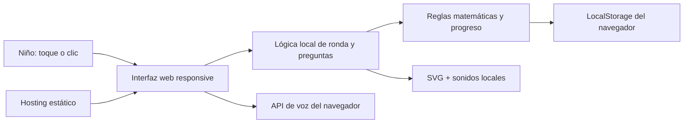

# Múltiplo — Arquitectura objetivo y restricciones técnicas
**Estado:** propuesta de arquitectura **para** el MVP, con evolución v1.2 documentada en Request #21. Cualquier cambio de tecnología significativo requiere registrar una decisión.

`progression.js` mantiene el estado local versionado con diez tablas, evidencia acotada a tres rondas, factores cubiertos y errores priorizables. `question-engine.js` es la única fuente de parejas dirigidas y distingue `actual`/`repaso`; `aprende.js` reutiliza `manzana.svg`. La persistencia sigue siendo defensiva y local.

### Inventario de consumidores Request #21

| Módulo | Consumidores directos | Contrato |
|---|---|---|
| `progression.js` | `question-engine.js`, `app.js`, pruebas v1.2 | tablas abiertas, dominio, migración y persistencia |
| `question-engine.js` | `app.js`, pruebas v1.2 | parejas dirigidas, modalidades y primer intento |
| `aprende.js` | `app.js`, `question-engine.js`, pruebas v1.2 | grupos, suma, producto y SVG |
| `app.js` | DOM de las cuatro vistas | navegación y render único |
| `star-guide.js` | `app.js`, pruebas Fola | audio opcional, cancelación y fallback textual |

Este inventario es la única ruta de Request #21; no se crea un motor paralelo.

## 1. Drivers
1. Lanzar un MVP jugable lo antes posible, sin construir infraestructura innecesaria.
2. Mantener una única experiencia web usable en celular, tablet y computador.
3. Soportar voz y texto, gráficos reutilizables y efectos simples.
4. No recopilar datos personales de un menor ni requerir cuentas.
5. Facilitar una implementación gradual desde issues GitHub con OpenSpec.
6. Mantener el sistema sencillo de probar, desplegar y mantener.

## 2. Arquitectura propuesta


**Tecnologías acordadas como enfoque mínimo:** HTML + CSS + JavaScript, PWA cuando el navegador lo permita, locuciones Fola pregrabadas, `localStorage`, archivos SVG y WAV versionados, hosting estático. No usar framework pesado, backend, autenticación, servidor de base de datos ni generación por IA para este MVP.

### Responsabilidades lógicas (no prescriben estructura de archivos)
| Responsabilidad | Qué debe hacer | Qué NO debe hacer |
|---|---|---|
| UI responsive | Mostrar vistas, controles y ayudas | Duplicar reglas matemáticas |
| Ronda | Coordinar aprendizaje + cuatro preguntas | Inventar niveles adicionales |
| Generador de preguntas | Elegir operaciones y distractores válidos | Generar más de una respuesta correcta |
| Progreso | Calcular dominio acumulado por tabla y factores distintos; tabla 1 usa `>=3/4` | Penalizar reintentos |
| Persistencia | Mantener niveles abiertos y preferencia de sonido | Enviar datos a servidores |
| Narrador | Sintetizar voz y manejar mute/replay | Impedir avanzar si falla voz |
| Activos visuales/sonoros | Reutilizar SVG y WAV del repositorio | Solicitar archivos de terceros en runtime |

Estas son divisiones conceptuales para claridad, no una autorización para introducir capas, patrones o abstracciones que ralenticen el MVP.

## 3. Datos y estado
Se necesita un conjunto **mínimo** de datos locales:
- `highestUnlockedLevel`: un entero entre 1 y 4 (o conjunto equivalente de niveles).
- `soundEnabled`: booleano.
- `recentMistakes`: lista opcional, limitada, de factores difíciles para priorizar rondas sin datos de identidad.
- `dataVersion`: opcional, si sirve para descartar datos corruptos o cambios de formato.

La ronda activa puede vivir en memoria. No se exige reanudar preguntas interrumpidas al cerrar la pestaña. **Una respuesta equivocada y corregida no se vuelve acierto inicial**: el puntaje debe depender del primer intento guardado en el estado de la pregunta.

Ejemplo conceptual (NO es API ni esquema obligatorio):
```json
{
  "highestUnlockedLevel": 2,
  "soundEnabled": true,
  "recentMistakes": [{"level": 1, "factor": 4}]
}
```

Las escrituras locales deben fallar de modo no catastrófico: si el navegador bloquea almacenamiento, permitir jugar la ronda y advertir con lenguaje apto para adulto, sin romper el juego.

## 4. Contenido y recursos
- [ASSETS.md](ASSETS.md) registra mascota SVG en cuatro expresiones, manzana SVG y cuatro efectos WAV originales.
- Usar fuentes Nunito/Baloo 2 solo cuando su carga/licencia sea compatible. **Fallback obligatorio** con tipografía del sistema.
- Las preguntas se generan a partir de las tablas 1–10 y factores 1–10: **no** es necesario un CMS ni una API de contenido.
- El producto requiere una interfaz en español. Textos y frases deben permitir asociar cantidades mostradas con narración.
- Las instrucciones usan locuciones Fola pregrabadas versionadas en release independiente, con preparación estática verificada por SHA-256.

## 5. PWA y distribución
- `manifest` e iconos de instalación; validar en navegadores elegidos.
- Una PWA **no garantiza** instalación idéntica en iOS, Android y escritorio ni voz idéntica. El navegador normal debe seguir funcionando.
- El funcionamiento **totalmente offline**, actualizaciones automáticas avanzadas y notificaciones push no son requisitos comprometidos del MVP. Cualquier caché debe evitar servir versiones inconsistentes.
- Hospedaje estático compatible con HTTPS para instalación donde aplique. La selección de proveedor/URL final está abierta.

## 6. Privacidad infantil por diseño
- No registrar nombre, edad exacta, escuela, correo, foto, ubicación ni identificador persistente del niño.
- No incluir telemetría, publicidad, trackers ni SDK de analítica.
- El progreso local no se sincroniza entre dispositivos. La prueba con el niño se documenta sin información personal identificable.
- Si en el futuro se cambia la recolección de datos, exigir una nueva decisión y revisión de privacidad específica para menores.

## 7. Accesibilidad y degradación elegante
- Botones grandes y accesibles con teclado además de clic/toque cuando sea razonable.
- Contraste legible y estados expresados por texto/iconos, no solo color.
- Voz no disponible → texto. Sonido desactivado → texto. Webfont fallida → fuente del sistema. PWA no instalable → aplicación web.
- Reducir animaciones si el usuario tiene reducción de movimiento activada.
- Evitar efectos sonoros excesivos y superpuestos.

## 8. Riesgos técnicos y decisiones pendientes de implementación
| Asunto | Restricción tomada | Libertad del implementador |
|---|---|---|
| UI | Responsive web, sin framework pesado | Organización de archivos, CSS y componentes reutilizables mínimos |
| Sonido | Reutilizar WAV del repositorio, soportar mute | Modo de reproducción compatible |
| Voz | API del navegador, español y fallback de texto | Gestión de cola/cancelación compatible |
| Estado | localStorage, sin sincronización | Claves y serialización |
| PWA | Instalable donde sea soportada | Configuración técnica de manifest/caché |
| Pruebas | Validar reglas y flujo E2E en tres factores de forma | Herramienta ligera de pruebas |
| Hosting | Estático con HTTPS cuando se despliegue | Proveedor final y pipeline mínimo |

## 9. Calidad y entrega
Todo cambio implementado debe:
- demostrar que el flujo completo puede ejecutarse, no solo renderizar un componente;
- comprobar matemáticamente respuestas y distractores;
- mantener la convención `a×b = a grupos de b` y el dominio acumulado v1.2;
- probar que el fallo de voz no bloquea el juego;
- respetar los requisitos del [modelo de aprendizaje](LEARNING_MODEL.md);
- evitar dependencias innecesarias para entregar el MVP.

No se necesita despliegue de producción para redactar y revisar los documentos de producto. Las acciones técnicas siguen a un cambio autorizado y especificado en OpenSpec.

## 10. Documento relacionado
[PRODUCT_VISION.md](PRODUCT_VISION.md) · [MVP.md](MVP.md) · [USER_EXPERIENCE.md](USER_EXPERIENCE.md) · [DECISIONS.md](DECISIONS.md) · [QUALITY_AND_VALIDATION.md](QUALITY_AND_VALIDATION.md).

## V3-03 — publicación y métricas opcionales

El artefacto Pages se compone con allowlist en `dist/pages`; no se publica la raíz del repo. Los filtros de Pages contemplan solo archivos del frontend y assets. La outbox del navegador usa una IndexedDB propia, separada del historial/progreso; la transmisión autorizada está activa desde 2026-11-22 y no bloquea el juego. El Worker de #43/D1 tiene pipeline PR local aislado; deploy y migración productivos son workflows manuales separados con Environment protegido. La operación, interruptores y evidencia están en [metrics/OPERATIONS.md](../metrics/OPERATIONS.md). No hay endpoint público de lectura ni scheduler/report automático.
